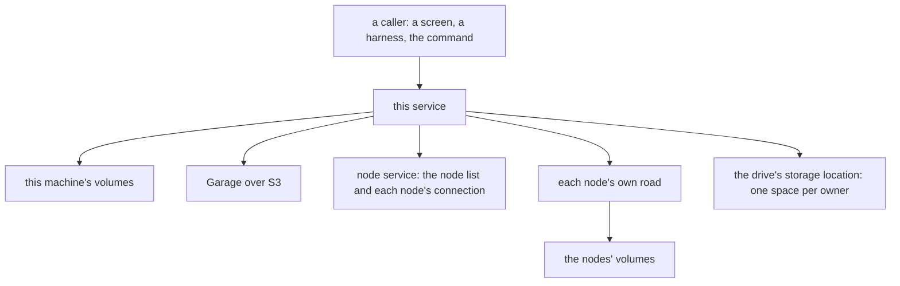
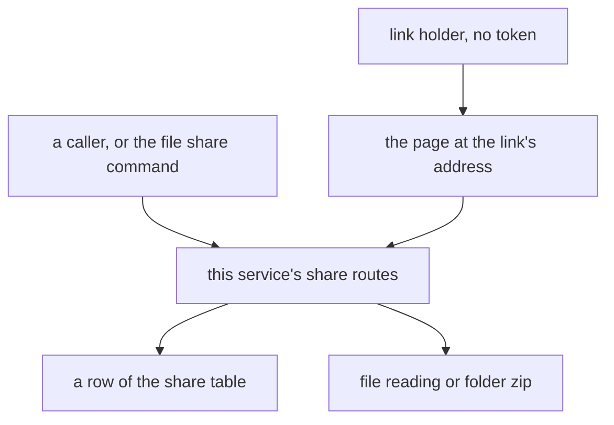

# The file viewer

- **What this says:** what a caller of this service may read and change on this machine and on the nodes
  of the node list, and in each owner's own BMO drive with its quota; how this service finds it, fences
  it, hands it over and changes it; and the share links that hand one entry to someone who holds no token.
  The routes, the command, the harness plugin and the settings are `docs/api.md`.
- **It does what a file explorer does,** on every place alike: reading, and making a folder, uploading,
  renaming, copying, moving and deleting (「Changing files」). The locations the deployment and the machines
  stand on are never changed (「Protected locations」).
- **It is for whoever holds the token, acting for an owner.** The token opens every route, and each request
  names the owner it acts for (「Owners and the two branches」): the machines are the administrator's alone,
  and the BMO drive is every owner's own space. The one road out to anyone else is a share link, which hands
  one file or folder to whoever holds it as a download and nothing else (「Share links」).

## Owners and the two branches

- **Every request but a link's own reading and the console bundle's manifest and words acts for an
  owner,** named by an opaque owner key the caller hands with it beside the role the reader holds
  (`docs/api.md`, 「Owners」). The console sets both from the person signed in; this service never learns
  who the person is, only the key, compared exactly, and the role, which opens the routes to a member and
  an administrator alike.
- **The files split in two branches:**
  - **the machines:** this machine's volumes, its Garage and the nodes' volumes (「The machines」, 「The
    places」). They are the administrator's alone, the owner whose key the settings name as the
    administrator's. To every other key they are answered as if they did not stand: none of them is
    listed, and a machine place, this machine or a node asked for is not found.
  - **the BMO drive:** one personal space for every owner key, the administrator's among them (「The BMO
    drive」). Each owner sees only their own.
- **A caller learns which branches are its from the service,** never from a name: the service answers
  whether the machines are the asking owner's, beside its drive's usage and quota, so a screen draws the
  machines for the administrator alone without knowing who that is.

## The machines

- **Every drive of every machine can be walked by the administrator:** this machine, and each node of the
  node list. The
  service keeps no list of machines of its own: it reads the node list from the node service whenever the
  administrator asks for the nodes or for one of them, answers the nodes as that list names them, and
  knows a node it is asked for by its name there.
- **This machine is named by its host name, a node by its label.**
- **This machine is read whenever it is asked for;** a node's drives are read only when that node is asked
  for, since each reading is a login over the network and a node that does not answer would otherwise hold
  up every other machine. A node that cannot be read is refused, saying why.

## The places

- **A place is one root the viewer may walk under,** and nothing above it. There are three kinds, each
  answering the same three questions (what stands at a path, what a file holds, and where it stands
  itself) in its own way:
  - **a volume:** a file system mounted on one of this machine's drives, named `volume:<mount>`;
  - **Garage:** the object storage this machine runs, walked as buckets, prefixes and objects, named
    `garage`, of the kind `store`;
  - **a node's volume:** a volume of a node, walked over that node's own road (「A node's drives」), named
    `node:<name>:<mount>`.
- **This machine's places are read again each time they are listed,** and a reading serves the requests
  of the next few seconds, since a folder of pictures asks for many at once. A drive plugged in or a mount
  taken away is seen at the next reading without a restart.
- **A volume of this machine says how much of it is free.**
- **A node's reading serves a minute,** and reading the node's machine again replaces it at once.

### The drives

- **The drives are read as a hardware monitor reads storage:** the block devices `lsblk` lists and the
  mounted file systems on them.
  - A volume is hung on the disk it stands on by following the block devices' parents, so a partition, a
    logical volume or an encrypted volume stands under its physical disk.
  - The kernel's own file systems and loop devices are no drive; a bind mount of a source already listed
    is not listed again.
  - A network share (NFS, SMB, an rclone or sshfs mount) is a drive of its own, named by its source.
  - A disk connected with nothing mounted is still listed, with no volume to open.
- **A drive is named by its model** (a disk whose model reads Tech stands as Tech) and carries its kind
  (NVMe, SSD, HDD, USB, a network share, virtual) and its size.
- **Each mounted volume is a place of its own,** named by where it is mounted. A volume holding other
  volumes' mount points shows them as the folders they are; walking into one walks onto the other drive.

### A node's drives

- **A node is reached by the connection the node service gives for it,** and by no other: an ssh node by a
  batch SSH login with the arguments the node service hands out, a jake node through its hub's exec aimed
  at its own agent. Each reading, listing and file is one script run over that road, in the language the
  road's shell speaks.
- **Its drives follow the rules for that kind of machine:**
  - **a Linux node:** `lsblk` and the mount table, by the same rules as this machine's drives;
  - **a WSL node:** the Windows disks with their lettered volumes, each volume walked where WSL mounts that
    letter, beside the virtual disk WSL runs from; a lettered volume WSL has not mounted has nothing to
    open;
  - **a Windows node** (a login answering in Windows PowerShell): its physical disks with their lettered
    volumes, each volume walked from its letter's root.
- **No credential leaves the service.** An ssh key is named by the login's arguments and a hub's token is
  read from its token file for the one request that needs it; neither goes into any answer.
- **A failed login says why in one line:** the last line OpenSSH wrote, or that ssh was ended by a signal.
- **A jake hub ends any one exec at five minutes,** a bound of the hub's own: a file read from a jake node
  breaks off there. The service sets no bound of its own on a node's road; a reading, a listing or a file
  ends when the node's script ends, the road breaks, or the caller goes away.

### Garage

- **Garage is a place of its own beside this machine's drives,** whatever drive it is installed on, so the
  drive holding its data shows Garage's raw block files as files while the Garage place shows the buckets
  and objects those blocks make up. Only this machine's Garage is read.
- **Where it is installed** is read from Garage's own configuration, at the path the settings name, as its
  data directory, and the place names the drive and the volume that directory stands on.
- **It is reached as any S3 client reaches it,** through the AWS profile the settings name, in the
  account's own AWS configuration: its endpoint, region and keys. Buckets are addressed by path, so no
  bucket needs a host name of its own.
- **A call to Garage waits for its answer,** however long it takes, a slow stream included: it ends with
  Garage's answer or a refused or broken connection.
- **No credential leaves the service.** The keys are read where the request is answered and go into no
  answer, no error and no log line; a failure names what failed and never the key it was signed with.
- **A machine with no Garage configuration has no Garage place.** One whose configuration stands but whose
  profile is missing or unreadable still has the place, carrying the reason it cannot be opened.
- **Walking it:** its top level is the buckets the profile's key may list; under a bucket, each level is
  the common prefixes up to the next `/` as folders and the objects at that level as files.

## The BMO drive

- **Where it stands is a setting, never a list of machines:** the storage location the settings name, of
  one of three kinds:
  - `local`: a root folder on this machine;
  - `node`: a root folder on a node of the node list, reached over the node's own road;
  - `s3`: a key prefix in a bucket of an S3 store, reached through an AWS profile.
  The service serves the `local` kind. A `node` or an `s3` location is a declared kind whose adapter is
  still to land: its place is listed carrying the reason it cannot be opened, and every reading and change
  of it is refused `storage-unready`; a `local` location with no root set is refused the same way. What
  follows holds for every kind.
- **Each owner's space is one folder under the root,** named by the owner key percent-encoded: every byte
  but an ASCII letter, a digit, `-` and `_` written as `%` and two hex digits. The folder is that key's
  alone, is never `.` or `..` and holds no `/`, and a copy of the root restores every space with nothing
  beside it. It is made the first time its owner reaches it. A key whose folder name would pass 255 bytes
  names no space.
- **It is the place named `drive`, whichever owner asks:** the name stands for the asking owner's own
  space, so no owner can name another's. It is walked, read, changed and zipped as a volume is (「Paths and
  the fence」, 「Reading a file」, 「Changing files」), its folder standing as its top: a link leading out of
  it opens nothing.
- **Nothing in an owner's space is protected from its owner.** The protected locations (「Protected
  locations」) guard the machine branch, which is how the root, standing among the deployment's data, is
  changed through the drive alone.
- **Copying and moving between the drive and a machine place** are the administrator's alone, since only
  the administrator reaches both; such a copy streams as any copy between two places does.
- **How the storage is backed up is the settings' statement,** answered beside the location, so the
  console shows the owner where the drive stands and how it is kept; the service itself copies nothing.

### Quotas

- **Each owner's space has a quota,** the bytes its files may hold together: the settings' default, 5 GiB,
  unless the administrator set another for that owner. The administrator's own space has none.
- **Usage is the bytes of the files in the space,** counted at each asking by walking the space; folders
  and links count nothing.
- **A write is judged before it starts.** A file written, or entries copied into the space, whose bytes
  would take the usage past the quota is refused 413 `quota-exceeded` before anything is changed:
  - a file written over frees the bytes of the file it replaces;
  - a copy counts every file it carries, and frees nothing it replaces;
  - a move or a rename inside the space, making a folder and deleting change no quota's judgement;
  - two writes started together are each judged against the usage before either, so together they may
    pass the quota by what the later one carries.
- **A quota set below the usage** refuses every write that adds bytes until files are deleted; nothing is
  deleted for it.
- **The administrator reads and sets each owner's quota** by the owner's key (`docs/api.md`, 「Owners」).

## Paths and the fence

- **A path is relative to its place,** written as names joined by `/`, the empty path being the place's
  top.
- **A path that would leave its place is refused,** before anything is opened:
  - a name that is `.` or `..`, an empty name between two slashes, or a name holding a NUL;
  - on a Windows node, also a name holding `\`, `:` or another character Windows does not allow in a name;
  - on a volume, a path any of whose steps has its real location (every symbolic link and junction
    followed) outside the volume's own real root, so a link pointing out of the volume opens nothing, nor
    anything reached through it.
- **A path that walks back into itself is refused** `link-loop`, so links never open a path without end.
  Each name is followed to its real location in turn, from the place's top, and a name is refused where its
  real location is one the path already stood at, or a folder holding one of them: a link to its own
  folder, to a folder above it, or back to a folder walked earlier in the path. A link to a folder beside or
  below is walked as the folder it leads to, once.
- **The path stays the names the caller walked,** links and all; the real locations are the service's to
  judge by and go into no answer.
- **On a node the fence stands on the node,** in the same script that then lists the folder or streams the
  file, so what is read is what was checked; a path walking back into itself is refused there by the same
  rule.
- **A place the request names must be one the current reading lists;** any other name is refused as not
  found, so the fence is the reading itself rather than a list kept beside it.

## Listing a folder

- **A folder is read whole once and handed out in pages.** The first request for a folder reads all its
  entries; that reading is kept for half a minute, and the pages after it are cut from it, so a folder of
  many thousand entries is read from disk, from Garage or from a node once while a caller reads it a page
  at a time. Asking with `fresh` reads it again, and any change in a place forgets what was kept for it.
- **Every page is cut from one order over the whole folder:** folders first, then by the column asked for
  (name, size or the time it last changed), ascending or descending, names compared without regard to case
  and with runs of digits compared as numbers. A sort changed reads the same kept folder again from its
  start.
- **A page holds 200 entries** where none is asked, and never more than 1000, and says how many the whole
  folder holds.
- **An entry carries** its place, its path and name, its kind (folder, file, or other: a device, a socket, a
  link that leads nowhere), its size in bytes for a file and the time it last changed. Garage's folders
  carry no size or time, since a prefix has neither; its buckets carry the time they were made.
- **A link is listed as what it leads to,** a folder or a file, and carries its target as the link itself
  writes it, so a screen marks it as a link and says where it leads. Anything that is no link carries no
  target, and Garage holds no links.
- **A reading waits for its answer:** a folder on a share that stopped answering, or on a node that stopped
  answering, holds its request until the share or the node answers, its connection breaks, or the caller
  goes away. The drive listing and a volume's free space wait the same way.

## Reading a file

- **A file is streamed as it is read,** never held whole in memory, with its type guessed from its name, its
  length and a name to save it under. A node's file streams as its road carries it.
- **Two ways to hand it over:** shown in a browser where the browser can (a picture, a PDF, a video, text),
  or saved as a download.
- **A file shown in a browser stands in a sandbox.** It may reach the browser from the same address as the
  screen that shows it, so this service hands it over with its type fixed, kept from any cache, and a
  sandbox around it: nothing on it runs, and it reaches nothing of that screen. A PDF is the one exception,
  since the browser's own viewer draws it and refuses to draw in a sandbox.
- **The bytes go out as the receiver takes them,** never faster, so a slow reader holds the reading back
  instead of filling memory; a stream that fails partway ends the download there as broken, and a receiver
  that goes away stops the reading behind it.
- **A preview may ask for its head alone:** the first so many bytes, which is how text and JSON are
  previewed without carrying a large file whole.
- **A part of a file is read by its byte range,** as HTTP asks for one, so a video plays from its first part
  at once and seeks anywhere without the file being carried whole:
  - every reading says it takes ranges;
  - one range in the request's `Range` header is answered as a partial answer naming where the part stands
    in the whole, read from where the part starts on every kind of place: a volume seeks to it, Garage is
    asked for that range, and a node's script reads from it;
  - a range that names no byte of the file (one starting past its end, or any range of an empty file) is
    refused as unsatisfiable, naming the whole length;
  - several ranges at once, or a header that is no range, are answered with the whole file.
- **Entries are read as one zip,** everything under them streamed into the archive as it is read, so
  neither the entries nor the zip is ever held whole, on this machine or on its way:
  - each file is stored as it stands, uncompressed, and each folder stands as an entry of its own so an
    empty one is kept; one folder asked for is stored with its entries under their paths from it, and
    several entries each under its own name at the zip's top;
  - the archive is ZIP64, so a file or a whole past 4 GB is carried as readily as a small one;
  - a folder is walked as a place of its own, cut down to it, by the same readings a listing and a file
    use: the fence stands at the folder, so a link leading out of it (elsewhere on the same volume as much
    as off it) opens nothing and is left out, as is a link walking back into a folder already walked and an
    entry that is neither a folder nor a file;
  - it is saved under the one entry's name, or under the name of the folder several stand in, and at a
    place's top under the place's own last name;
  - its length is not known before it ends, so it is answered with no length and takes no range;
  - an entry that fails once the zip has started cuts the answer short, which the receiver sees as a broken
    download rather than a zip quietly missing a file.

## Changing files

- **Every change names its place and its paths,** each fenced exactly as a reading is (「Paths and the
  fence」), and the place of a new entry is its folder's.
- **Making a folder, writing a file, renaming, moving, deleting.** Each acts on one place; a folder is
  deleted with everything in it, and the top of a place is never renamed, moved or deleted.
- **Copying** takes entries of one place into a folder of the same place or of another:
  - inside one place, the place does it itself (the file system, the node's own shell, or Garage's own
    copy), so nothing travels through the service;
  - between two places, every file is streamed from the one into the other and every folder made again;
  - a folder is never copied or moved into itself or anything under it.
- **Moving** inside one place is done by the place itself, and moving an entry onto the folder it already
  stands in changes nothing. A move between two places is a copy, then the deletion of each entry copied,
  which the caller asks once the copy has answered, so nothing is taken before all of it has arrived.
- **A name already taken in the folder is a conflict,** settled by what the request asks:
  - refused, before anything is changed, naming every entry that would collide;
  - replaced: the entry standing there is deleted first;
  - kept both: the arriving entry takes the first free name with a number added before its ending,
    `name (2).txt`;
  - skipped: the colliding entries are left out and the rest go ahead.
  Writing a file's bytes replaces where nothing else is asked, as a write does; every other change refuses.
- **A file is written as it streams in,** never held whole in memory on the way; it is written beside its
  final name and put in place only once it has arrived whole, at the length it was sent with, so a broken
  upload leaves nothing half written.
  - On a Linux or WSL node over an ssh login it streams into the script's standard input.
  - On a jake node the hub carries it whole to a scratch file on the node first, since an exec has no
    standard input; the script puts it in place and takes the scratch file away.
  - On a Windows node, whose PowerShell stops reading its standard input after its first few tens of
    kilobytes, it is written to a scratch file on this machine, put into the login's home by SFTP, and
    moved in place by the script; both scratch files are taken away.
- **Garage has folders only as prefixes:** making one writes an empty object named for the prefix, and
  renaming, moving or deleting a prefix acts on every object under it. A folder made at Garage's top is a
  bucket, and a bucket is deleted only once it is empty.
- **A change that takes long runs until it ends,** as a reading does: a copy of a large folder is never cut
  short.
- **Each change answers** with the entries as they ended, and is an event of the service's stream
  (`docs/api.md`, 「Events」).

## Protected locations

- **A change is refused where it would land inside a protected location,** or would change the location
  itself, or would take one with it (deleting a folder that holds one), judged by the real location with
  every link followed. Reading them is untouched.
- **The lists are this service's settings,** each kept by the kind of machine it is for (`docs/api.md`,
  「Settings」):
  - **a machine read by a POSIX shell:** the operating system's own folders; the entries standing directly
    in `/`; folders under the login's home, by default the deployment's data and deploy trees, a jake
    agent's own folder, the user's service units, the ssh and AWS keys and a coding harness's own folder;
    and every entry of a named folder under the home whose name begins with a given word, such as the
    checkouts of a repository;
  - **this machine besides:** the folders the settings add, such as the deployment's data root, this
    service's own store, and Garage's data and metadata folders, whose raw blocks only Garage may write;
  - **a Windows machine:** the folders the environment names for Windows and its programs, and folders under
    the user's profile, by default its ssh keys;
  - **Garage:** the buckets whose name begins with one of the settings' words, where backups stand.
- **On a node the check runs on the node,** in the script that makes the change, against the node's own
  home and its own folders.

## Share links

- **A share link hands one file or folder to someone who holds no token,** as a download and nothing else:
  no listing, no preview, no other entry.
- **This service keeps the links:** it alone reads and writes their rows in its own store, judges a link's
  expiry and hands out what it opens. Whatever draws a page for a link's holder reads the link and its
  content from this service.

### What a link is

- **A row of the share table,** naming the entry by its place and its path, the owner key it was made
  for, whether it is a file or a folder, who made it where the maker names someone, when, and when it stops
  opening. A link is a row rather than a signature: it is listed, read back and taken away before its time.
- **Links work in both branches.** A link of a machine place is the administrator's; a link of `drive`
  opens the space of the owner it was made for, whoever later holds it.
- **A row that names no owner is the administrator's,** and the service writes the administrator's key into
  it as it starts: the old archive's links arrive with none.
- **The token is the whole of the link:** wide, random and URL-safe, so no place or path can be read out of
  it or altered in it.
  - It never begins with a dash: a token is handed on command lines, such as the command's `--remove` or a
    `curl`, and every one of them reads a leading dash as an option of its own.
- **The request names nothing but the token.** The place, the path and the owner come from the row, so a
  link reaches its own entry and, for a folder, only what the folder's zip carries, which no link under the
  folder leads out of.
- **One live link per entry of an owner:** asking for a link where one stands hands back the one that
  stands, and a link is given another life by being taken away and made again.
- **It follows the path, not the file.** An entry renamed, moved or deleted leaves its link opening
  nothing, and a new file put at the same path is what the link then hands out.

### How long it lives

- **Its maker names when it stops opening,** or that it has no end. The command takes days instead, a week
  where none is named.
- **Its expiry is read at every opening,** and a link whose time has passed is refused as gone (410) while
  a token that never named one is refused as not found (404). Rows whose time has passed are swept at each
  listing and making of links; nothing relies on the sweep having run.
- **Taking a link away** deletes its row, and the link stops at once.

### What the holder sees

- **A link's address is the settings' share address followed by its token.** Whatever serves that address
  reads the link from this service: its name, file or folder, and when it stops opening, with a download.
  A link gone or never made says which.
- **The download is the link's content,** which a download manager or `curl` can be handed as it stands
  wherever the page's server passes it on, with its byte range, to this service.
  - A file is streamed as a download through the file reading (「Reading a file」), its byte range passed
    on, so a broken download resumes where it stopped and a large file is never held whole.
  - A folder is its zip (「Reading a file」), named after the folder, with no range to resume by.
  - A file on a jake node breaks off where its hub ends the exec (「A node's drives」); a large one is
    finished by resuming.
- **Nothing it answers is kept by a cache,** since a link runs out.

### Making and ending links

- **Each owner lists and takes away its own links;** another owner's link is answered as if it did not
  stand. A link's holder needs no owner (「What the holder sees」).
- **On the Files screen** of this repository's console plugin bundle, a file or folder is shared from its
  context menu and from the toolbar's menu, and the screen lists the owner's live links.
- **From a shell, `bmo-drive file share`,** acting for the administrator (`docs/api.md`, 「The command」):
  - `bmo-drive file share <path> [--days <n> | --forever]`: a link for a file or folder on this machine, the
    path read as it stands on this machine and given to the volume it lies on, the deepest mount point that
    holds it;
  - `--place <name>` reads the path inside that place instead, as the places are named: Garage or a node's
    volume;
  - `--list` prints every live link, and `--remove <token>` takes one away;
  - it prints the address of the link's page to hand over, and refuses an entry that is not there before
    making any row.
- **Every link is made through the share routes,** the only code that writes the table. The entry is read
  before any row is written, and whether it is a file or a folder is judged there, never taken from the
  caller.

## The Files screen

- **The console plugin bundle's Files screen** (README.md, 「The console plugin bundle」) walks the places
  as a file explorer does: a tree of places and folders, the open folder's list, and a preview.
- **The signed-in owner's BMO drive stands at the top of its tree,** with its usage and its quota beside its
  name (the usage alone where it has none), and opens where the address names no place and the machines
  are not the owner's.
- **The machines stand below it only where the service answers that they are the owner's:** this machine
  with its drives and Garage, then each node of the node list. The screen reads no name and no node list to
  decide it; for any other owner it reads neither the machines nor the node list.
- **The usage is read again after every change** the screen makes, and a write refused over the quota is
  said in the screen's own words.
- **The address names the place, the folder and the chosen file,** so the browser's history steps through
  the folders walked and a reload opens the same folder.
- **The last folder each viewer opened is remembered in the browser,** under the viewer's owner key as the
  service answers it, as a convenience: the screen opened with an address that names no place opens at
  that folder, where the place is still one the viewer reaches. A remembered folder that can no longer be
  listed is forgotten and the screen opens where it would with nothing remembered. Storage the browser
  refuses or clears leaves nothing remembered and changes nothing else.
- **A link is marked as one** in the open folder's list, with the target it names, and a link refused for
  walking back into itself is said in one sentence in the screen's own words; the path bar keeps the names
  walked.
