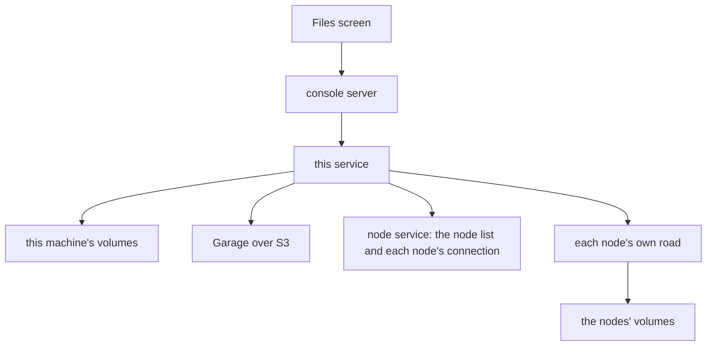
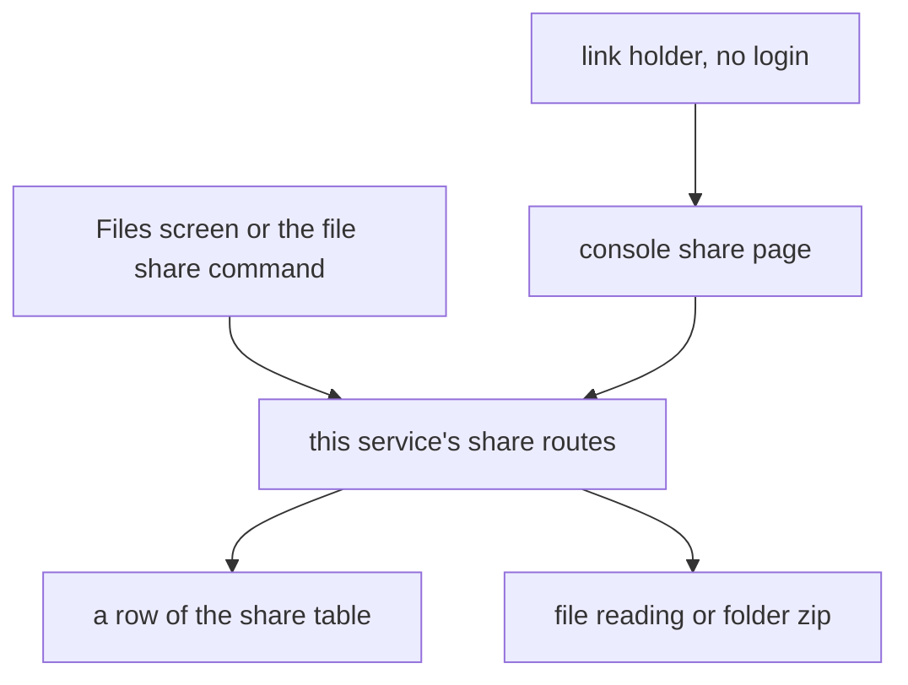

# The file viewer

- **What this says:** what the console's Files screen may read and change on this machine and on the
  nodes of the node list, how this service finds it, fences it, hands it over and changes it, and the
  share links that hand one entry to someone with no login. The routes, the command and the settings
  are `docs/api.md`.
- **It does what a file explorer does,** on every place alike: reading, and making a folder,
  uploading, renaming, copying, moving and deleting (「Changing files」). The locations the deployment
  and the machines stand on are never changed (「Protected locations」).
- **It is the administrator's alone.** The console opens its screen and its routes to the administrator
  and to nobody else. The one road out is a share link the administrator makes, which hands one file or
  folder to whoever holds it as a download and nothing else (「Share links」).

## The machines

- **Every drive of every machine can be walked:** this machine, then each node of the node list in the
  list's order. The viewer keeps no list of machines of its own: the node list is the node service's,
  read from it each time it is needed, and a node the node service marks as this machine is not listed
  again, since this machine stands for it.
- **This machine is named by its host name, a node by its label.**
- **This machine is read whenever the screen opens or reads again;** a node's drives are read only
  when they are asked for, since each reading is a login over the network and a node that does not
  answer would otherwise hold up every other machine. A node that cannot be read says why in its
  own answer.

## The places

- **A place is one root the viewer may walk under,** and nothing above it. There are three kinds,
  each answering the same three questions — what stands at a path, what a file holds, and where it
  stands itself — in its own way:
  - **a volume:** a file system mounted on one of this machine's drives, known as `volume:<mount>`;
  - **Garage:** the object storage this machine runs, walked as buckets, prefixes and objects, known as
    `garage`;
  - **a node's volume:** a volume of a node, walked over that node's own road (「A node's drives」),
    known as `node:<name>:<mount>`.
- **This machine's places are read again as the screen opens or reads again,** and a reading serves
  the requests of the next few seconds — a folder of pictures asks for many at once. A drive plugged
  in or a mount taken away is seen at the next reading without a restart.
- **A node's reading serves a minute,** and reading the node's drives again replaces it at once.

### The drives

- **The drives are read as a hardware monitor reads storage:** the block devices `lsblk` lists and the
  mounted file systems on them.
  - A volume is hung on the disk it stands on by following the block devices' parents, so a
    partition, a logical volume or an encrypted volume stands under its physical disk.
  - The kernel's own file systems and loop devices are no drive; a bind mount of a source already
    listed is not listed again.
  - A network share (NFS, SMB, an rclone or sshfs mount) is a drive of its own, named by its source.
  - A disk connected with nothing mounted is still listed, with no volume to open.
- **A drive is named by its model** — a disk whose model reads Tech stands as Tech — and carries its
  kind (NVMe, SSD, HDD, USB, a network share, virtual) and its size.
- **Each mounted volume is a place of its own,** named by where it is mounted. A volume holding
  other volumes' mount points shows them as the folders they are; walking into one walks onto the
  other drive.

### A node's drives

- **A node is reached by the connection the node service gives for it,** and by no other: an ssh node
  by a batch SSH login with the arguments the node service hands out, a jake node through its hub's
  exec aimed at its own agent. Each reading, listing and file is one script run over that road, in the
  language the road's shell speaks.
- **Its drives follow the rules for that kind of machine:**
  - **a Linux node:** `lsblk` and the mount table, by the same rules as this machine's drives;
  - **a WSL node:** the Windows disks with their lettered volumes, each volume walked where WSL mounts
    that letter, beside the virtual disk WSL runs from; a lettered volume WSL has not mounted has
    nothing to open;
  - **a Windows node** (a login answering in Windows PowerShell): its physical disks with their
    lettered volumes, each volume walked from its letter's root.
- **No credential leaves the service.** An ssh key is named by the login's arguments and a hub's token
  is read from its token file for the one request that needs it; neither goes into any answer.
- **A failed login says why in one line:** the last line OpenSSH wrote, or that the login did not
  finish in time.
- **A file read from a jake node is cut off at five minutes,** the longest a hub lets one exec run.

### Garage

- **Garage is a place of its own beside this machine's drives,** whatever drive it is installed on,
  so the drive holding its data shows Garage's raw block files as files while the Garage place shows
  the buckets and objects those blocks make up. Only this machine's Garage is read.
- **Where it is installed** is read from Garage's own configuration, at the path the settings name,
  as its data directory, and the place names the drive and the volume that directory stands on.
- **It is reached as any S3 client reaches it,** through the AWS profile the settings name, in the
  account's own AWS configuration: its endpoint, region and keys. Buckets are addressed by path, so no
  bucket needs a host name of its own.
- **No credential leaves the service.** The keys are read where the request is answered and go into
  no answer, no error and no log line; a failure names what failed and never the key it was
  signed with.
- **A machine with no Garage configuration has no Garage place.** One whose configuration stands but
  whose profile is missing or unreadable still has the place, carrying the reason it cannot be
  opened.
- **Walking it:** its top level is the buckets the profile's key may list; under a bucket, each level
  is the common prefixes up to the next `/` as folders and the objects at that level as files.

## Paths and the fence

- **A path is relative to its place,** written as names joined by `/`, the empty path being the
  place's top.
- **A path that would leave its place is refused,** before anything is opened:
  - a name that is `.` or `..`, an empty name between two slashes, or a name holding a NUL;
  - on a Windows node, also a name holding `\`, `:` or another character Windows does not allow in
    a name;
  - on a volume, a path whose real location — every symbolic link and junction followed — is not
    under the volume's own real root, so a link pointing out of the volume opens nothing.
- **On a node the fence stands on the node,** in the same script that then lists the folder or
  streams the file, so what is read is what was checked.
- **A place the request names must be one the current reading lists;** any other name is refused as
  unknown, so the fence is the reading itself rather than a list kept beside it.

## Listing a folder

- **A folder is read whole once and handed out in pages.** The first request for a folder reads all
  its entries; that reading is kept for half a minute, and the pages after it are cut from it, so a
  folder of many thousand entries is read from disk, from Garage or from a node once while the screen
  loads it a page at a time. Asking with `fresh` reads it again, and any change in a place forgets
  what was kept for it.
- **Every page is cut from one order over the whole folder:** folders first, then by the column asked
  for — name, size or modification time — ascending or descending, names compared without regard to
  case and with runs of digits compared as numbers. A sort changed reads the same kept folder again
  from its start.
- **A page holds 200 entries** where none is asked, and never more than 1000.
- **An entry carries** its name, its kind (folder, file, or other — a device, a socket, a link that
  leads nowhere), its size in bytes for a file and its modification time. Garage's folders carry no
  size or time, since a prefix has neither; its buckets carry the time they were made.
- **A reading that does not end is cut off:** a folder on a share that stopped answering, or a node
  that stopped answering, is refused after some seconds rather than holding the request.

## Reading a file

- **A file is streamed as it is read,** never held whole in memory, with its type guessed from its
  name, its length and a name to save it under. A node's file streams as its road carries it.
- **Two ways to hand it over:** shown in the browser where the browser can (a picture, a PDF, a
  video, text), or saved as a download.
- **A file shown in the browser stands in a sandbox.** It reaches the browser from the console's own
  address, so this service hands it over with its type fixed, kept from any cache, and a sandbox
  around it: nothing on it runs, and it reaches nothing of the console. A PDF is the one exception,
  since the browser's own viewer draws it and refuses to draw in a sandbox.
- **The bytes go out as the receiver takes them,** never faster, so a slow reader holds the reading
  back instead of filling memory; a stream that fails partway ends the download there as broken, and
  a receiver that goes away stops the reading behind it.
- **A preview may ask for its head alone:** the first so many bytes, which is how text and JSON are
  previewed without carrying a large file whole.
- **A part of a file is read by its byte range,** as HTTP asks for one, so a video plays from its first
  part at once and seeks anywhere without the file being carried whole:
  - every reading says it takes ranges;
  - one range in the request's `Range` header is answered as a partial answer naming where the part
    stands in the whole, read from where the part starts on every kind of place: a volume seeks to
    it, Garage is asked for that range, and a node's script reads from it;
  - a range that names no byte of the file — one starting past its end, or any range of an empty
    file — is refused as unsatisfiable, naming the whole length;
  - several ranges at once, or a header that is no range, are answered with the whole file.
- **A folder is read as one zip,** everything under it streamed into the archive as it is read, so
  neither the folder nor the zip is ever held whole, on this machine or on its way:
  - each file is stored as it stands, uncompressed, under its path from the folder, and each folder
    stands as an entry of its own so an empty one is kept;
  - the archive is ZIP64, so a file or a whole past 4 GB is carried as readily as a small one;
  - the folder is walked as a place of its own, cut down to it, by the same readings a listing and
    a file use: the fence stands at the folder, so a link leading out of it — elsewhere on the same
    volume as much as off it — opens nothing and is left out, as is an entry that is neither a folder
    nor a file;
  - it is saved under the folder's name, and at a place's top under the place's own last name;
  - its length is not known before it ends, so it is answered with no length and takes no range;
  - an entry that fails once the zip has started cuts the answer short, which the receiver sees as a
    broken download rather than a zip quietly missing a file.

## Changing files

- **Every change names its place and its paths,** each fenced exactly as a reading is (「Paths and the
  fence」), and the place of a new entry is its folder's.
- **Making a folder, uploading a file, renaming, deleting.** Each acts on one place; a folder is
  deleted with everything in it, and the top of a place is never renamed or deleted.
- **Copying and moving** take entries of one place into a folder of the same place or of another:
  - inside one place, the place does it itself — the file system, the node's own shell, or Garage's
    own copy — so nothing travels through the service;
  - between two places, every file is streamed from the one into the other and every folder made
    again, and a move deletes what it took only once all of it has arrived;
  - a folder is never copied or moved into itself or anything under it, and moving onto the folder
    an entry already stands in changes nothing.
- **A name already taken in the folder is a conflict,** settled by what the request asks:
  - refused by default, before anything is changed, naming every entry that would collide;
  - replaced: the entry standing there is deleted first;
  - kept both: the arriving entry takes the first free name with a number added before its ending,
    `name (2).txt`;
  - skipped: the colliding entries are left out and the rest go ahead.
- **A file is uploaded as it streams in,** never held whole in memory on the way; it is written
  beside its final name and put in place only once it has arrived whole, at the length it was sent
  with, so a broken upload leaves nothing half written.
  - On a Linux or WSL node over an ssh login it streams into the script's standard input.
  - On a jake node the hub carries it whole to a scratch file on the node first, since an exec has
    no standard input; the script puts it in place and takes the scratch file away.
  - On a Windows node, whose PowerShell stops reading its standard input after its first few tens of
    kilobytes, it is written to a scratch file on this machine, put into the login's home by SFTP,
    and moved in place by the script; both scratch files are taken away.
- **Garage has folders only as prefixes:** making one writes an empty object named for the prefix,
  and renaming, moving or deleting a prefix acts on every object under it. A folder made at
  Garage's top is a bucket, and a bucket is deleted only once it is empty.
- **A change that takes long is not cut off** the way a reading is: a copy of a large folder runs
  until it ends.
- **Each change answers** with the names it ended under.

## Protected locations

- **A change is refused where it would land inside a protected location,** or would change the
  location itself, or would take one with it — deleting a folder that holds one — judged by the real
  location with every link followed. Reading them is untouched.
- **The lists are this service's settings,** each kept by the kind of machine it is for (`docs/api.md`,
  「Settings」):
  - **a machine read by a POSIX shell:** the operating system's own folders; the entries standing
    directly in `/`; folders under the login's home — by default the deployment's data and deploy
    trees, a jake agent's own folder, the user's service units, the ssh and AWS keys and Claude Code's
    own folder; and every entry of a named folder under the home whose name begins with a given word,
    such as the checkouts of a repository;
  - **this machine besides:** the folders the settings add, such as the deployment's data root, this
    service's own store, and Garage's data and metadata folders, whose raw blocks only Garage may
    write;
  - **a Windows machine:** the folders the environment names for Windows and its programs, and folders
    under the user's profile, by default its ssh keys;
  - **Garage:** the buckets whose name begins with one of the settings' words, where backups stand.
- **On a node the check runs on the node,** in the script that makes the change, against the node's
  own home and its own folders.

## Share links

- **A share link hands one file or folder to someone with no login,** as a download and nothing else:
  no listing, no preview, no other entry.
- **This service keeps the links:** it alone reads and writes their rows in its own store, judges a
  link's expiry and hands out what it opens. The console draws the screen and the share page and passes
  their requests on.

### What a link is

- **A row of the share table,** naming the entry by its place and its path, whether it is a file or a
  folder, who made it, when, and when it stops opening. A link is a row rather than a signature: it is
  listed, read back and taken away before its time.
- **The token is the whole of the link:** wide, random and URL-safe, so no place or path can be read
  out of it or altered in it.
  - It never begins with a dash: a token is handed on command lines, such as the command's `--remove`
    or a `curl`, and every one of them reads a leading dash as an option of its own.
- **The request names nothing but the token.** The place and the path come from the row, so a link
  reaches its own entry and, for a folder, only what the folder's zip carries, which no link under
  the folder leads out of.
- **One live link per entry:** asking for a link where one stands hands back the one that stands, and
  a link is given another life by being taken away and made again.
- **It follows the path, not the file.** An entry renamed, moved or deleted leaves its link opening
  nothing, and a new file put at the same path is what the link then hands out.

### How long it lives

- **The spans are this service's list** — an hour, six hours, a day, a week, thirty days, or no
  end — and the screen offers a file's link a week first. The command takes days instead, a week where
  none is named.
- **Its expiry is read at every opening,** and a link whose time has passed is refused as gone (410)
  while an address that never named one is refused as not found (404). Rows whose time has passed are
  swept at each reading and making of links; nothing relies on the sweep having run.
- **Taking a link away** deletes its row, and the link stops at once.

### What the holder sees

- **The address is the console's `/share/files/<token>`,** under the console's public address, which
  this service's settings name.
- **The page names the entry and offers one button:** its name, file or folder, a file's size, and
  when the link stops opening, with a download button. A link gone or never made says which on the
  same page.
- **The download is the console's `/api/share/files/<token>/download`,** which the button opens and
  which a download manager or `curl` is handed as it stands. The console passes it, with its byte
  range, to this service and streams the answer back as it comes.
  - A file is streamed as a download through the file reading (「Reading a file」), its byte range
    passed on, so a broken download resumes where it stopped and a large file is never held whole.
  - A folder is its zip (「Reading a file」), named after the folder, with no range to resume by.
  - A file on a jake node is cut off at five minutes as every reading there is; a large one is
    finished by resuming.
- **Nothing it answers is kept by a cache,** since a link runs out.

### Making and ending links

- **On the Files screen** a file or folder is shared from its context menu and from the toolbar's
  menu, and the screen lists every live link.
- **From a shell, `bmo file share`** runs this service's command (`docs/api.md`, 「The command」):
  - `bmo file share <path> [--days <n> | --forever]` — a link for a file or folder on this machine,
    the path read as it stands on this machine and given to the volume it lies on, the deepest mount
    point that holds it;
  - `--place <id>` reads the path inside that place instead, as the screen names places — Garage or
    a node's volume;
  - `--list` prints every live link, and `--remove <token>` takes one away;
  - it prints the page's address to hand over and the download address beside it, and refuses an
    entry that is not there before making any row.
- **Both make links through one module,** which alone writes the table. The entry is read before any
  row is written, and whether it is a file or a folder is judged there, never taken from the caller.
